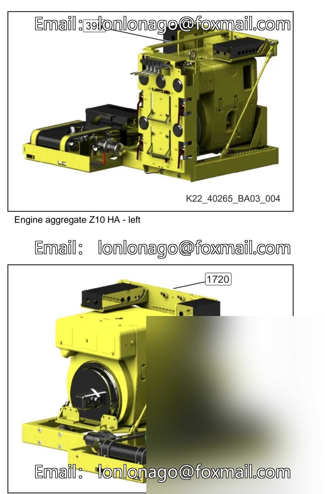
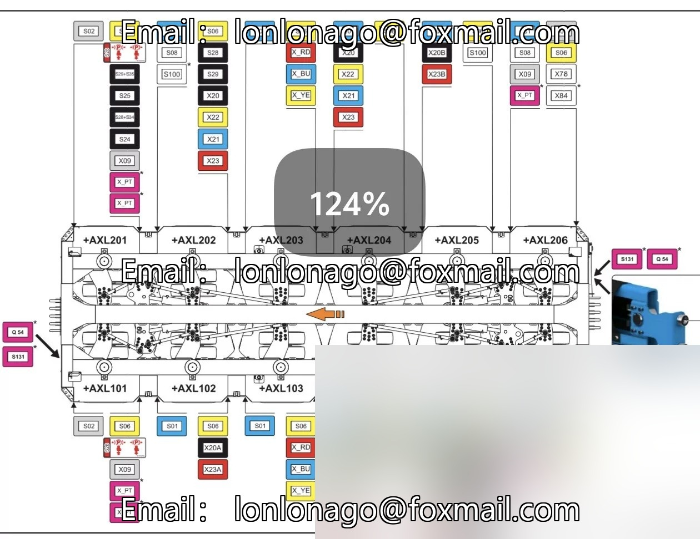
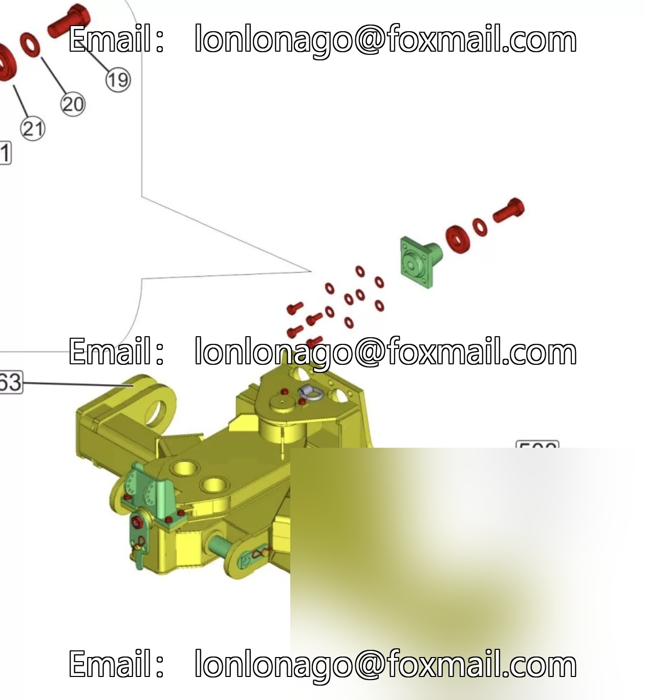
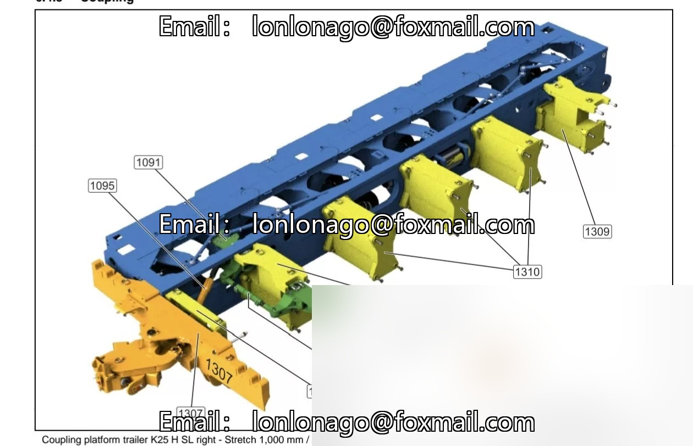
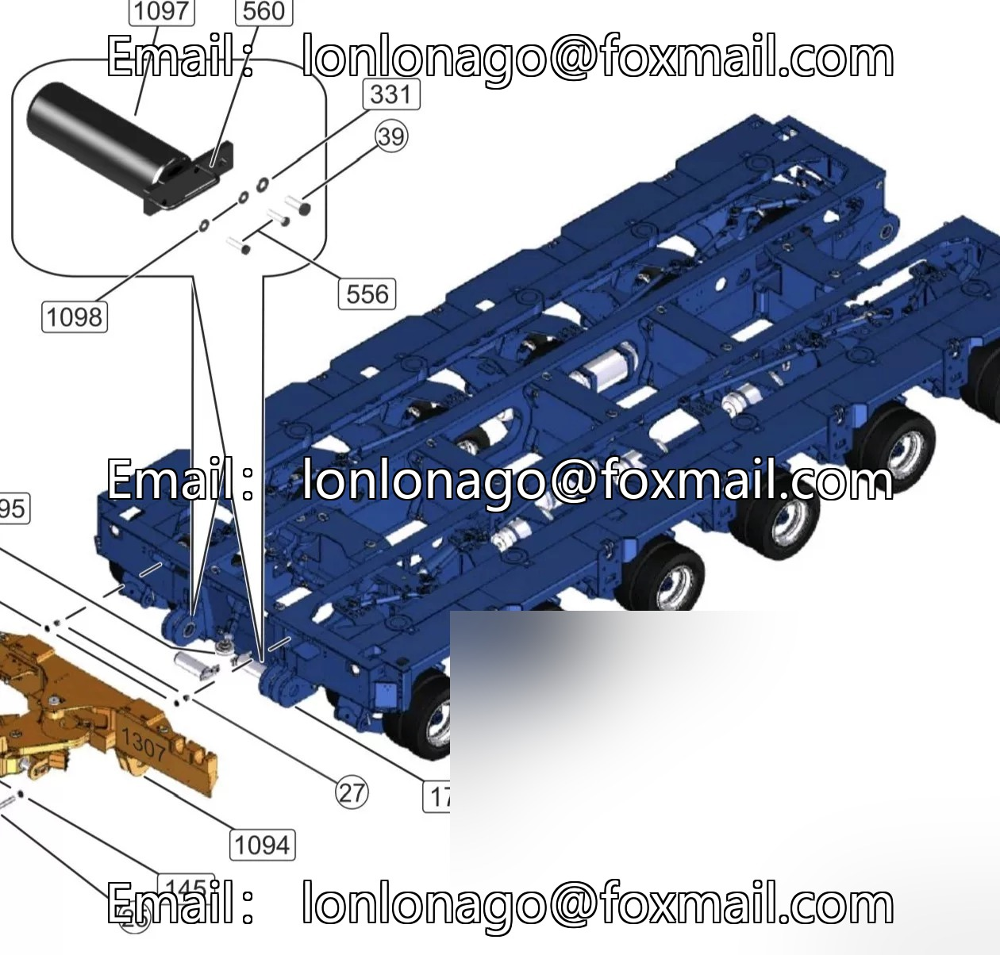

# The operation manual for K25 H1 modular transportation system of KAMAG Company in Germany, PD

## Body

The Operation Manual for K25 H1 Modular Transportation System of Germany KAMAG Company, PDF , 150 pages.
The materials are system-level operation instructions, suitable for reference for related studies of construction machinery and military equipment.
The electronic file, refunds if sold.
2. Core technical principles and structure

This equipment can become a "moving giant" because of its complex system integration inside:

Power unit (PPU - Power Pack Unit):
SPMT usually does not come with an engine, but is equipped with an independent power head (PPU). This power head is installed at one end of the flatcar or placed separately, and power is delivered to all axes through hydraulic pipelines.

Full hydraulic drive and static pressure transmission:
It eliminates the traditional mechanical transmission and adopts static hydraulic drive. Each axle is driven by an independent hydraulic motor, and this continuous-speed system makes the vehicle extremely stable during heavy-load starting and climbing, with powerful power output.

Independent suspension and multi-directional steering system:
The vehicle has dense tires at the bottom (multiple axles can be seen in the image). Each axle is equipped with an independent hydraulic suspension system; when encountering rugged roads, wheels can independently extend and retract to keep the goods absolutely level. At the same time, it supports multi-wheel steering, enabling straight driving, slanted driving, 360-degree rotation in place, or "walking across" (crawling).

Modular splicing technology:
This is the soul of SPMT. Multiple K25 modules can be connected end-to-end via shafts or quick connection devices. Under the coordination of the electronic control system, the entire massive fleet can achieve synchronized lifting, synchronized turning, and synchronized driving, like a vehicle with hundreds of wheels as a whole.
802574936

The manual covers the operation of the German KAMAG K25 H1 modular transport system, detailing system-level technical principles, structure and supporting hardware.

<!-- AI_ENRICHED -->

## Images

## Payment

Here is a pay link on Stripe ( https://buy.stripe.com/3cs8yP7sY87d0vu9AB ). Please contact me lonlonago@foxmail.com after funding $89, and I will send you a complete data files , thank you!

